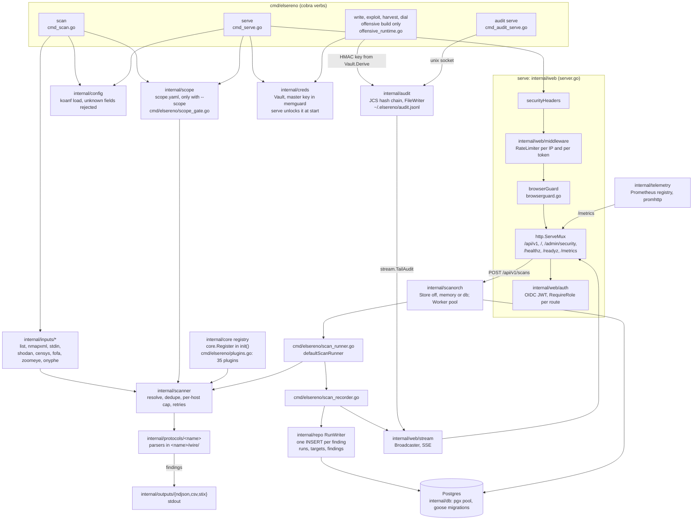

# Architecture

ElSereno is a single-binary Go application following a hexagonal
architecture. The domain (`internal/core`) depends only on the Go standard
library; adapters (db, web, protocols, inputs, outputs) depend on core.

## Directory layout

See `.context/architecture.md` for the authoritative layout and the
rationale behind each package.

## Data flow

Mapped from the code on 2026-10-18 (`cmd/elsereno/cmd_scan.go`,
`cmd_serve.go`, `scan_runner.go`, `scan_recorder.go`,
`offensive_runtime.go`, `internal/web/server.go`). Every box names the
package that does the work. Two paths share the plugin registry and the
scanner: the CLI `scan` writes findings to stdout, and `serve` runs
queued jobs and stores findings in Postgres.



Plain-text summary of the same flow:

```text
scan   -> config + scope -> inputs -> scanner -> protocols -> outputs (stdout)
serve  -> config + vault + scope
       -> web: securityHeaders -> RateLimiter -> browserGuard -> mux (OIDC per route)
       -> scanorch job -> scan_runner -> scanner -> protocols
       -> scan_recorder -> repo.RunWriter (Postgres) + stream (SSE)
write-class verbs (offensive) -> audit FileWriter, HMAC-keyed from the vault
audit file -> stream.TailAudit -> dashboard live feed
```

What the diagram does not show, because the code does not do it yet:

- `internal/bus` is a `doc.go` with no code: no event bus carries
  findings or audit entries. The batched `pgx.CopyFrom` subscriber of
  ADR-008 is not built; `serve` writes each finding with one `INSERT`
  (`internal/repo/runwriter.go`), and the CLI `scan` writes none to
  the database.
- `internal/audit` has a Postgres writer (`OpenDBWriter`, `audit_log`
  table) and a file-to-database sync, but no command wires either: the
  chain lives in the JSONL file.

## Key invariants

- Domain (`internal/core`) depends only on stdlib.
- Every I/O call carries a `context.Context` with a deadline.
- `signal.NotifyContext` is the root cancellation; second signal during
  drain exits immediately with `128 + signum`.
- Findings persistence is designed as `pgx.CopyFrom` batched (1000
  findings or 1 s, ADR-008) and not built: today `serve` inserts each
  finding with one `INSERT` (see Data flow). Audit entries are appended
  in order to one file by one writer (the hash chain is
  non-parallelisable).
- Plugins register in `init()` with explicit `core.Register(...)` calls
  in `cmd/elsereno/plugins.go` (or `plugins_offensive.go` for the
  offensive build).
- Parsers live in `internal/protocols/<name>/wire/` and operate on byte
  slices with length checks before slicing.
- `internal/exec.SafeCommand(ctx, CommandSpec)` is the **only** way to
  spawn subprocesses; the `--` separator is inserted deterministically
  (ADR-024).

## Module boundaries

| Package | Responsibility |
|---------|----------------|
| `internal/core` | Domain interfaces, entities, value types, shared errors. |
| `internal/bus` | Designed event bus (ADR-008); a `doc.go` only, no code yet. |
| `internal/config` | Koanf loader, validator, unknown-field rejector. |
| `internal/db` | pgx pool, migrations (goose), DDL. |
| `internal/audit` | JCS hash chain (genesis / tombstone / rebase). |
| `internal/creds` | Encrypted vault (AES-GCM + Argon2id + HKDF). |
| `internal/exec` | `SafeCommand` with typed `CommandSpec` (no command spawns a subprocess yet). |
| `internal/render` | `SafeBytes` sanitiser for target-controlled bytes. |
| `internal/telemetry` | Prometheus, OTel, progress bar; secret redaction on the standard logger (`NewRedactWriter`, wired in `main.go`, PITF-099). |
| `internal/web` | HTTP server, auth (dev mode or OIDC JWT), browser guard against cross-site requests and DNS rebinding (no CSRF token; PITF-092), per-IP and per-token rate limiter (PITF-100), health endpoints. |
| `internal/repo` | Run, target and finding rows the dashboard reads; `RunWriter` records serve's scans. |
| `internal/scanorch` | Scan jobs, schedules, cron, worker pool (`--scan-store` off, memory or db). |
| `internal/scanner` | Resolve, dedupe, per-host concurrency cap and retries around each probe. `CircuitBreaker` exists in the package but nothing wires it yet. |
| `internal/scope` | Optional `scope.yaml`, applied with `--scope` by every network command (ranges, ports, protocols, dial blocked numbers). |
| `internal/scoring` | Multi-factor scoring engine. |
| `internal/triage` | Grouping (quick-wins, strategic). |
| `internal/doctor` | Cross-platform preflight. |
| `internal/wizard` | Interactive configuration wizard (huh). |
| `internal/protocols/<name>` | Protocol plugins (35 in the default build, `elsereno plugins list`). |
| `internal/inputs/{shodan,censys,nmapxml,list,stdin}` | Input adapters. |
| `internal/outputs/{ndjson,csv,html,cef,syslog}` | Output adapters. |
| `internal/proxy` | TCP/UDP proxy framework. |
| `internal/repl` | Generic REPL. |
| `offensive/{write,exploits,harvest,dial,sandbox}` | Offensive build modules (build tag `offensive`). |
